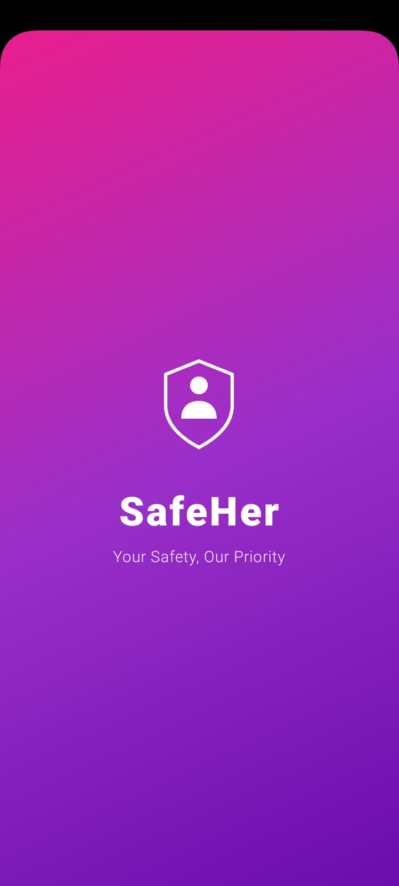
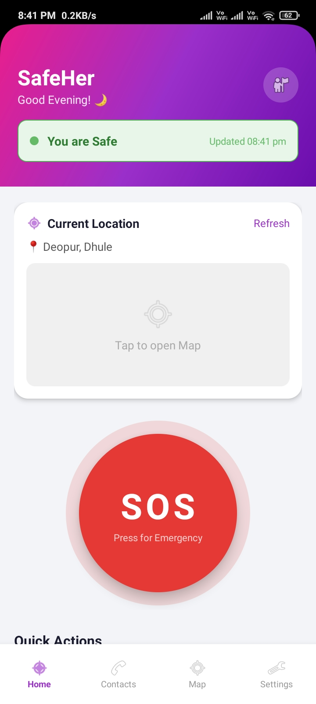
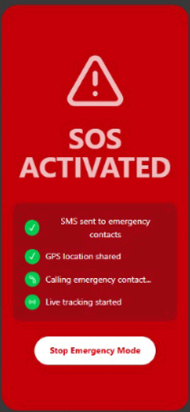
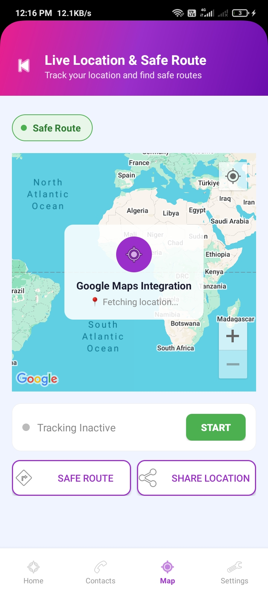

# 🛡️ SafeHer — Women Safety App Using Machine Learning

> **"Your Safety, Our Priority"**

A smart Android-based women safety application that uses **Machine Learning** to automatically detect unsafe situations and send **SOS alerts with live location** to emergency contacts — without any manual action from the user.

---

## 📱 Screenshots

| Splash Screen | Home Screen | SOS Alert | Live Tracking |
|---|---|---|---|
|  |  |  |  |

---

## 🚨 Problem Statement

Women often face unsafe situations while traveling alone, especially at night. Existing safety apps require **manual action** — pressing a button or making a call — which may not be possible in real danger. SafeHer solves this by **automatically detecting danger** through sensors and ML, and sending help without any user input.

---

## ✅ Features

- 🤖 **ML-based Unsafe Detection** — Random Forest model analyzes 6 real-time sensor inputs every 30 seconds
- 🚨 **Auto SOS System** — 3-minute countdown alert; triggers automatically if user doesn't respond
- 📱 **SMS to Emergency Contacts** — sends SOS message with live location link to all contacts
- 🗺️ **Live GPS Tracking** — emergency contacts see your moving location updated every 10 seconds
- 🔐 **Firebase Authentication** — secure login and registration
- 👥 **Emergency Contacts Manager** — add, edit, delete, prioritize contacts stored in Firestore
- 📍 **Google Maps Integration** — real-time map with location tracking
- 📳 **Shake Detection** — shake phone to trigger SOS
- ⚙️ **Customizable SOS Message** — personalize the alert message sent to contacts
- 🌙 **Time-aware Safety** — automatically considers time of day in risk assessment

---

## 🧠 How ML Detection Works

Every 30 seconds, the app collects **6 inputs** from phone sensors:

| Parameter | Source | Values |
|---|---|---|
| Speed | GPS | 0=slow, 1=walking, 2=running |
| Heart Rate | Estimated from movement | 70/90/140 bpm |
| Time of Day | System clock | 0=day, 1=evening, 2=night |
| Acceleration | Accelerometer | 0=calm, 1=moderate, 2=shaking |
| Location Type | GPS + time | 0=safe, 1=moderate, 2=risky |
| Sound Level | Microphone | 0=quiet, 1=moderate, 2=loud |

These inputs are sent to a **Flask API** running a **Random Forest Classifier**. The model returns:
- `status` → Safe or Unsafe
- `unsafe_probability` → risk percentage (0–100%)

If **Unsafe** → SOSAlertActivity launches with 3-minute countdown.

---

## 🏗️ Tech Stack

| Layer | Technology |
|---|---|
| Android App | Java, XML |
| ML Model | Python, Scikit-learn (Random Forest) |
| ML API | Flask (REST API) |
| Authentication | Firebase Auth |
| Database | Firebase Firestore |
| Live Location | Firebase Realtime Database |
| Maps | Google Maps SDK |
| Live Tracking Page | Firebase Hosting (HTML/JS) |
| API Integration | Retrofit2 |
| Location Services | FusedLocationProviderClient |

---

## 🔄 App Flow

```
App Opens → Login / Register
     ↓
Home Screen loads — sensors start collecting data
     ↓
Every 30 seconds → ML API called with real sensor data
     ↓
     ├── SAFE   → green status badge, continue monitoring
     └── UNSAFE → SOSAlertActivity opens with countdown
                       ↓
           ┌──────────────────────────────┐
           │  User taps "I'm Safe"        │ → dismissed, back to monitoring
           │  User taps "SOS Now"         │ → immediate SOS
           │  No response in 3 minutes    │ → auto SOS triggered
           └──────────────────────────────┘
                       ↓
           SMS sent to all emergency contacts
           Live location uploaded to Firebase every 10 sec
           Contact opens link → sees live map
```

---

## 🗂️ Project Structure

```
Women-Safety-ML/
├── app/src/main/
│   ├── java/com/example/women_safety_ml/
│   │   ├── MainActivity.java          # Home screen + ML integration
│   │   ├── LoginActivity.java         # Firebase Auth login
│   │   ├── RegisterActivity.java      # Firebase Auth register
│   │   ├── ContactsActivity.java      # Emergency contacts (Firestore)
│   │   ├── MapActivity.java           # Google Maps + live tracking
│   │   ├── SettingsActivity.java      # App settings
│   │   ├── SOSAlertActivity.java      # 3-min countdown SOS screen
│   │   ├── SOSManager.java            # SMS sending logic
│   │   ├── LiveLocationTracker.java   # Firebase Realtime DB uploads
│   │   ├── SensorDataCollector.java   # Accelerometer + microphone
│   │   ├── SafetyDataHelper.java      # Sensor → ML input conversion
│   │   ├── BaseActivity.java          # Bottom navigation base
│   │   ├── ApiService.java            # Retrofit API interface
│   │   ├── RetrofitClient.java        # Retrofit client setup
│   │   ├── PredictionRequest.java     # ML request model
│   │   └── PredictionResponse.java    # ML response model
│   └── res/
│       ├── layout/                    # XML layouts
│       └── drawable/                  # Icons and shapes
│
├── SAFETY_MODEL/
│   ├── app.py                         # Flask API server
│   ├── create_model.py                # ML model training
│   ├── train_model.py                 # Training script
│   ├── predict.py                     # Prediction script
│   ├── safety_model.pkl               # Trained model
│   └── data.csv                       # Training data
│
└── SafeHer-Web/
    └── public/
        └── live_tracking.html         # Live location web page
```

---

## ⚙️ Setup Instructions

### Prerequisites
- Android Studio (latest)
- Python 3.x
- Firebase account
- Google Maps API key

### 1. Clone the repository
```bash
git clone https://github.com/PatilDeepanjali/Safe-Her.git
cd Safe-Her
```

### 2. Firebase Setup
- Create a Firebase project
- Enable Authentication (Email/Password)
- Enable Firestore Database
- Enable Realtime Database
- Download `google-services.json` → place in `app/` folder

### 3. Add API Keys
In `AndroidManifest.xml`:
```xml
<meta-data
    android:name="com.google.android.geo.API_KEY"
    android:value="YOUR_GOOGLE_MAPS_API_KEY"/>
```

In `RetrofitClient.java` — update with your PC's IP:
```java
private static final String BASE_URL = "http://YOUR_PC_IP:5000/";
```

### 4. Run the ML API
```bash
cd SAFETY_MODEL
pip install flask scikit-learn pandas joblib
python app.py
```

### 5. Run the Android App
- Open project in Android Studio
- Sync Gradle
- Connect Android device
- Run the app

---

## 👥 Team

| Name | Role |
|---|---|
| Aakanksha Padole | Android Development + UI |
| Deepanjali Patil | ML Model + Firebase Integration |
| Rohini Mali | Backend + API Integration |
| Nandini Jadhav | Testing + Documentation |

**Faculty Guide:** Dr. M. N. Agrawal
**College:** SSVPS B.S. Deore College of Engineering
**Department:** Computer Engineering
**Class:** TY Computer — Group 26

---

## 🔮 Future Improvements

- Voice keyword detection ("Help", "Bachao")
- Smartwatch integration for real heart rate
- Safe route suggestion using Maps Directions API
- Fake call feature to escape danger
- Larger ML training dataset for better accuracy
- Cloud deployment of Flask API

---

## 📄 License

This project is for educational purposes — SSVPS B.S. Deore College of Engineering, 2026.

---

<div align="center">
  <strong>Built with ❤️ for Women Safety</strong>
</div>